# DenTech — система для зуботехнических лабораторий

Наряды лаборатории в цифре: каждая работа со своими этапами (ложка → шаблон → примерки → сдача), чатом с врачом,
файлами (STL, фото, PDF) и историей. Врачи клиник работают в своём кабинете или прямо из Telegram,
клиники получают уведомления в WhatsApp.

## 👉 Попробовать демо: **https://abushcka.github.io/dentech-demo/**

На странице входа нажмите кнопку нужной роли — пароль вводить не нужно. Работает на компьютере и телефоне.

| Роль | Логин | Пароль | Что видит |
|---|---|---|---|
| Владелец | `admin` | `demo12345` | всё: наряды, финансы, отчёты, прайс, сотрудники |
| Администратор | `gulnara` | `admin12345` | приём нарядов, клиники, оплаты |
| Техник | `dilmurod` | `tech12345` | свои работы и этапы, сдельная оплата (цены скрыты) |
| Врач клиники | `kanat` | `doctor12345` | только свои наряды, чат с лабораторией |

Данные вымышленные: можно смело нажимать всё — создавать наряды, двигать этапы, писать в чат. Изменения видите только вы и пропадают после обновления страницы.

## Что умеет

- **Наряды** — наглядная зубная формула (верхняя и нижняя челюсть, форма каждого зуба), цвет, импланты, компоненты, срочность, сроки
- **Справочники** — системы имплантов, компоненты, этапы и цвета владелец ведёт сам
- **Вход и регистрация** — по номеру телефона или e-mail с кодом подтверждения (код присылает бот лаборатории в Telegram, WhatsApp или почта), восстановление пароля
- **Этапы и примерки** — кто и когда получил/отправил, подтверждение врача, возврат на доработку
- **Дата изготовления этапа** — техник ставит «Изготовить к», врач видит «Будет готово», просрочки подсвечиваются и приходят в утренней сводке
- **Чат работы** — врач и техник общаются внутри наряда, внутренние заметки клиника не видит
- **Участники чата** — нажмите на заголовок чата: кто в работе, добавить врача или техника, все фото и файлы работы
- **Файлы и сканы** — STL, ZIP, фото, PDF прямо при создании наряда; ZIP открывается в программе без распаковки, STL — в 3D
- **3D рядом с зубной формулой** — переключатель «Формула | 3D-модель» собирает все сканы работы, в том числе из архивов
- **Telegram-бот** — врач отправляет заявку, видит статус, отвечает прямо из уведомления (даже с часов)
- **WhatsApp** — уведомления клиникам со служебного номера лаборатории
- **Финансы** — оплаты клиник, акт сверки, долги, зарплата техников по сделке
- **Отчёты руководителя** — весь бизнес в 8 разрезах: выручка и оплаты, клиники, врачи, виды работ, техники, сроки и качество, долги по возрасту, загрузка; сравнение с прошлым периодом, выгрузка в Excel
- **ИИ-помощник** — фото бумажного наряда → готовая форма, ответы на вопросы по данным
- **Работает на телефоне** — устанавливается как приложение

## Скриншоты

**Отчёты руководителя: весь бизнес за полгода** (войдите как Владелец → «Отчёты»)
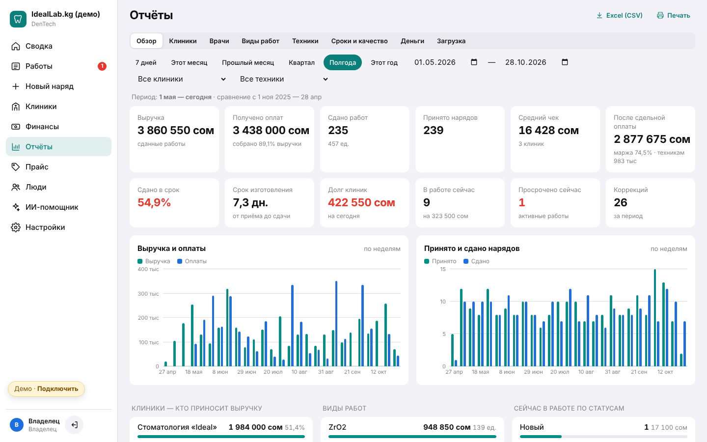

**Деньги: долги клиник по возрасту, оплаты**
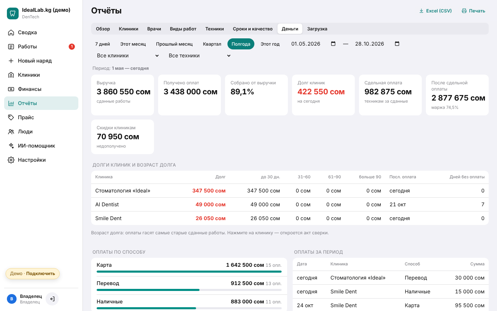

**Дата изготовления каждого этапа**
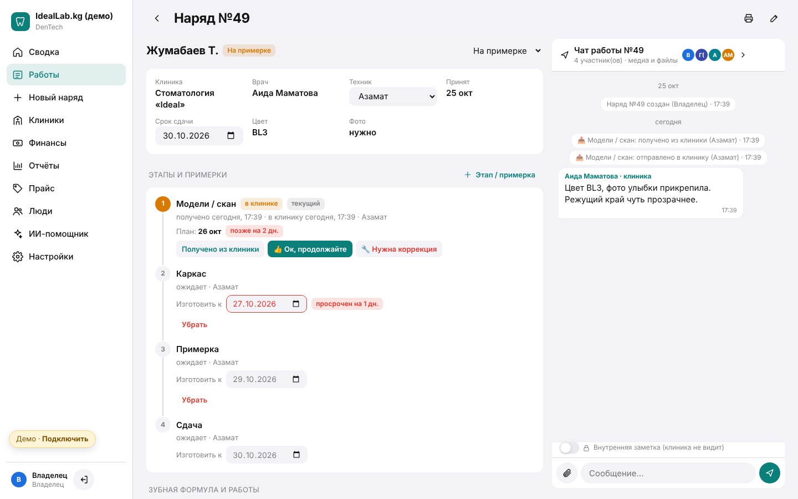

**Скан в 3D рядом с зубной формулой** (в демо — наряд №48, архив со сканом верхней челюсти)
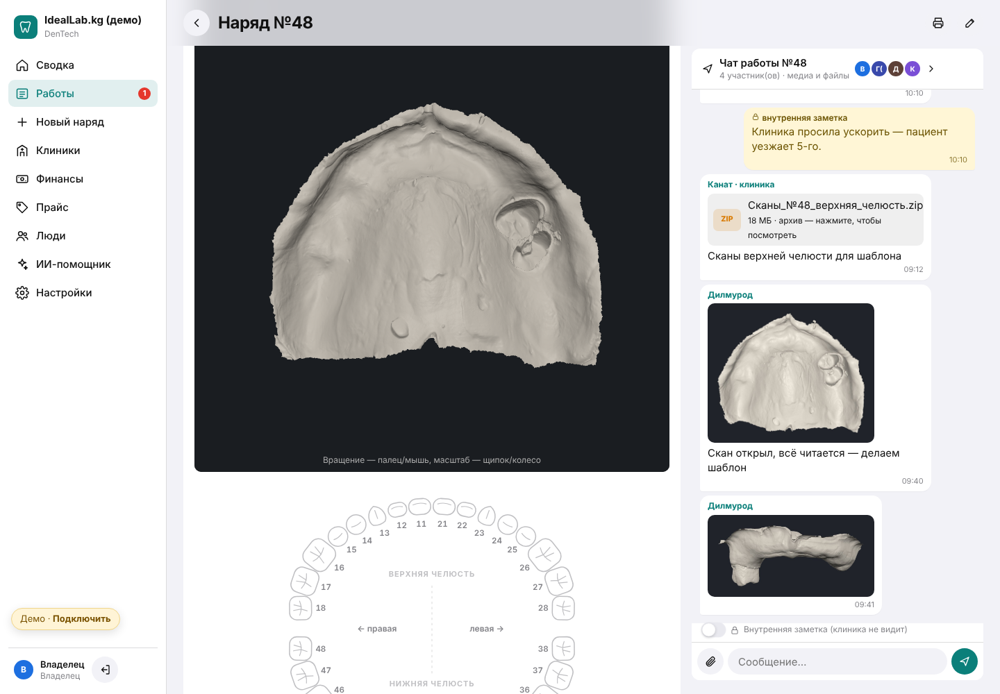

**Архив ZIP открывается прямо в программе**
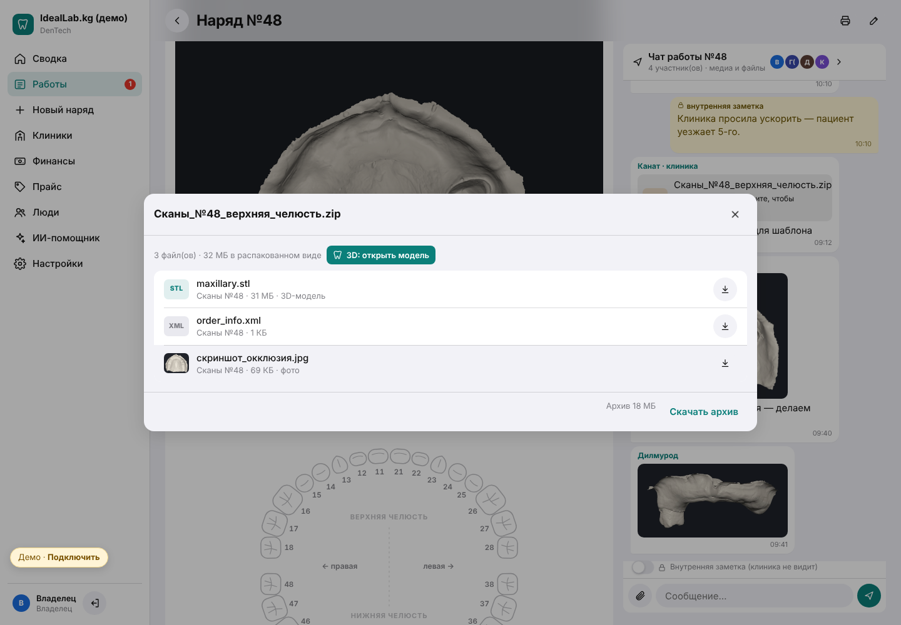

**Сводка владельца**
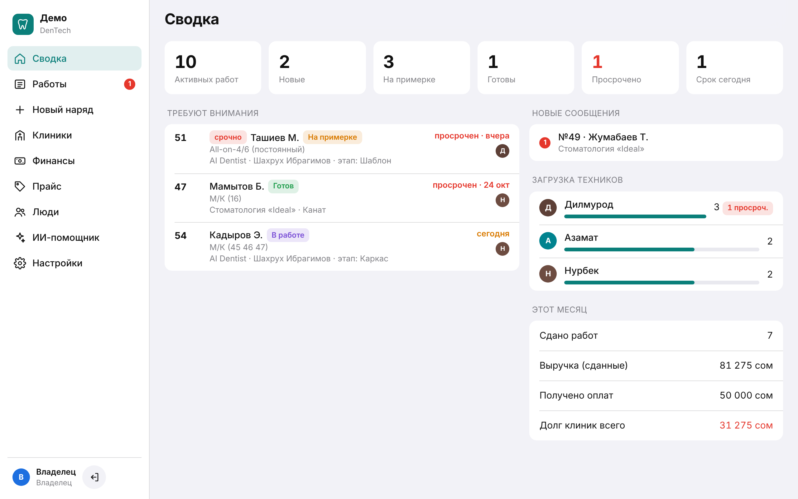

**Наряд: этапы и чат с врачом**
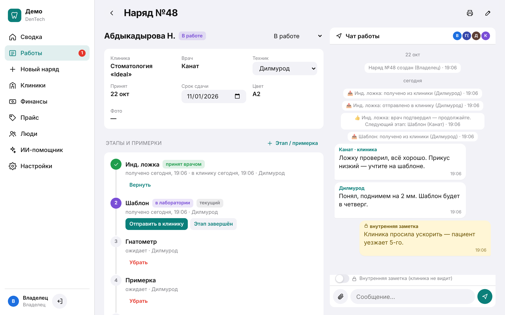

**Новый наряд: зубная формула**
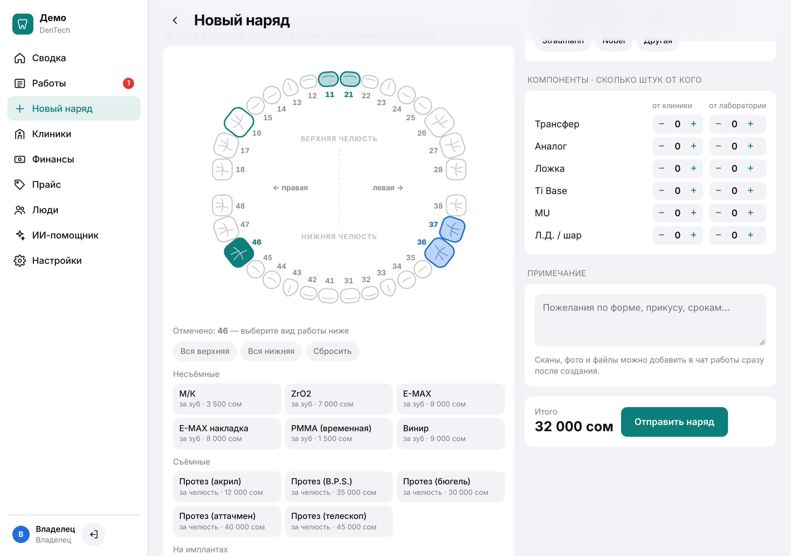

**Справочники: этапы, импланты, компоненты**
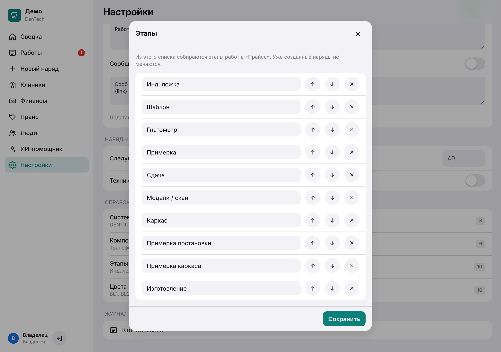

**Список работ**
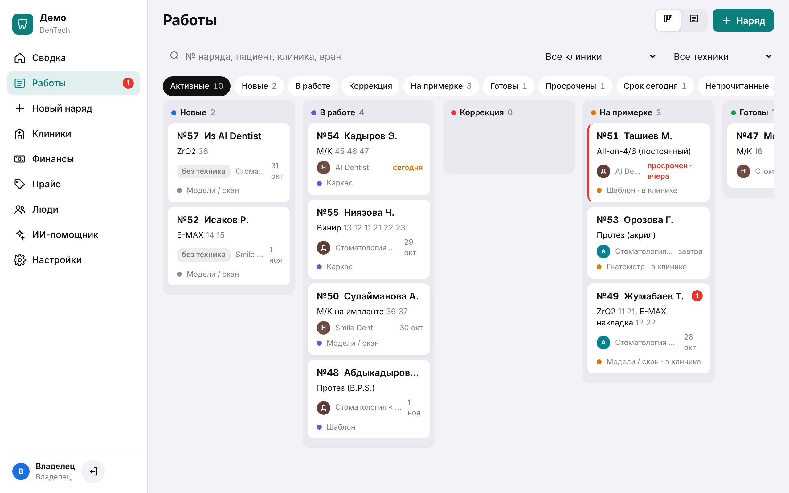

| Вход в демо (телефон) | Кабинет врача (телефон) |
|---|---|
| 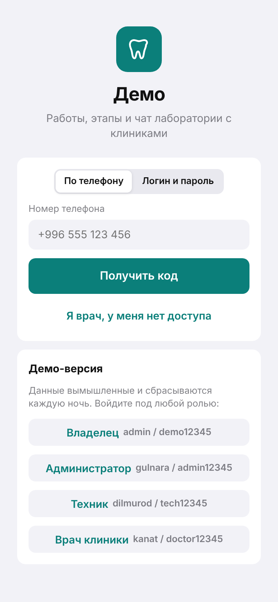 | 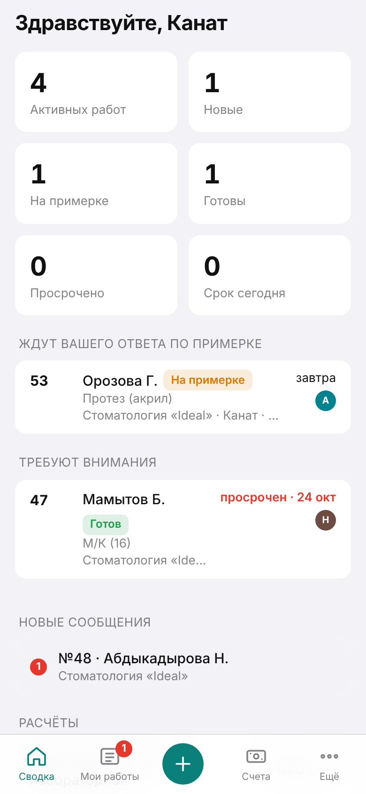 |

## Подключить свою лабораторию

WhatsApp: [+996 501 777 010](https://wa.me/996501777010)
